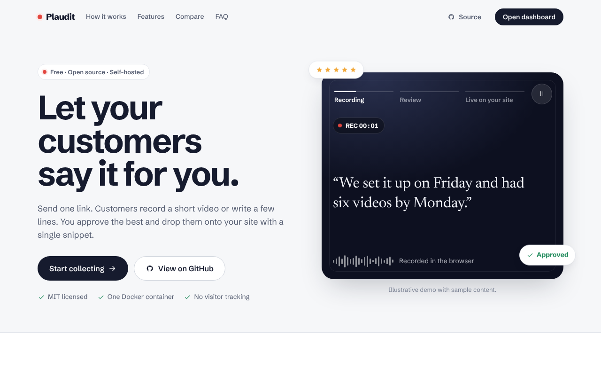
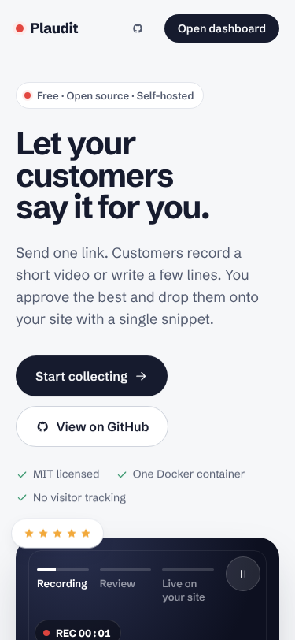
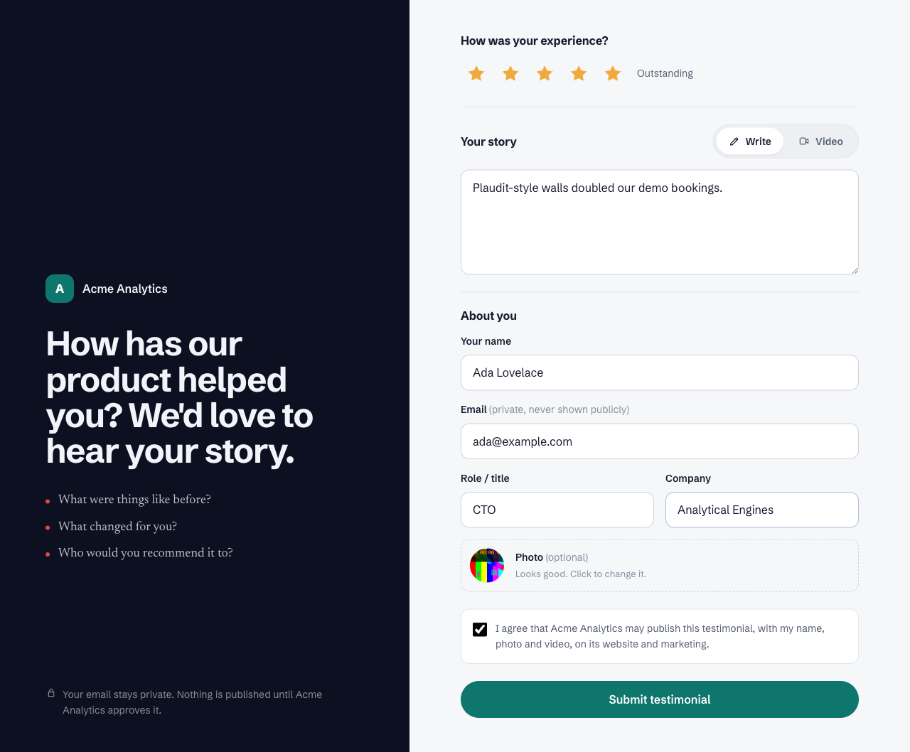
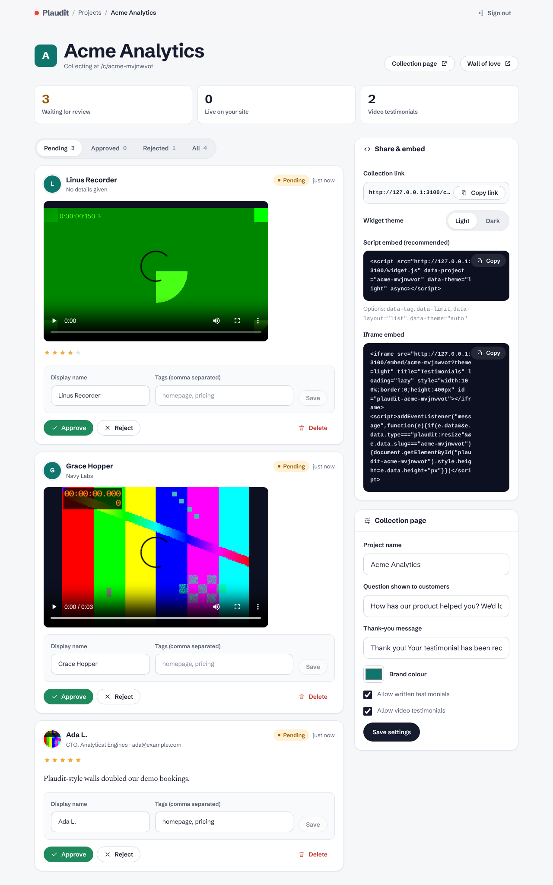
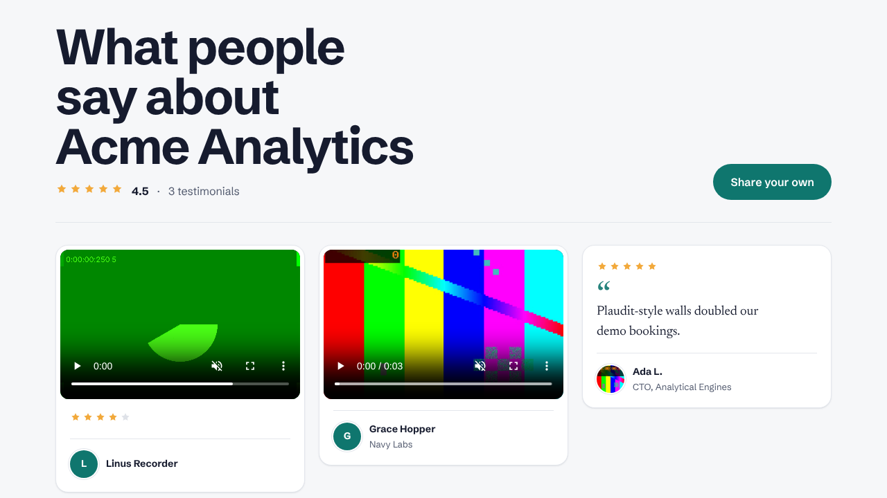
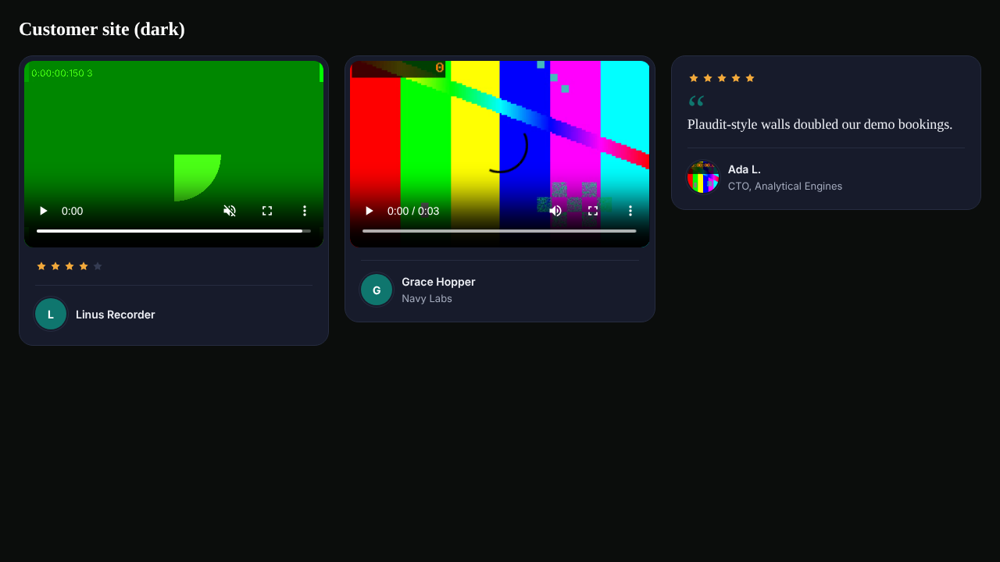

# Plaudit

Plaudit is a free, open-source and self-hostable app for collecting **video and text testimonials**. Customers record a video or write a few lines on a hosted page. You approve the best ones, and they appear on your site through a single embed snippet.

It has no testimonial caps, no forced branding and no third-party trackers, and it is MIT licensed.

| Home page (desktop) | Home page (mobile) |
|---|---|
|  |  |

[Full-length home page screenshot](docs/screenshots/home-full.png)

| Collection page | Admin dashboard |
|---|---|
|  |  |

| Wall of love | Embedded widget (dark theme, on another site) |
|---|---|
|  |  |

## Features

- **Collection page** per project, at `/c/<slug>`, which asks for:
  - a star rating
  - a written testimonial, **or a video**: recorded in the browser (MediaRecorder) or uploaded
  - name, email (kept private), role, company and photo
  - a consent checkbox
- **Dashboard**: approve, reject, tag or delete testimonials, and edit the display name. Also configure the collection page.
- **Wall of love** at `/wall/<slug>`: a public grid of approved testimonials, with video playback, in light or dark.
- **Embeds**:
  - a single `<script>` tag that renders into Shadow DOM, so your site's CSS can't break it
  - or an auto-resizing `<iframe>`
  - light, dark or auto theme, and filtering by tag
- **Self-hosted**: SQLite plus local disk, one Docker volume, `docker compose up`.

## Quick start (Docker)

```bash
git clone https://github.com/sureshkumaranbu/open-video-testimonial.git plaudit
cd plaudit
cp .env.example .env    # then edit ADMIN_EMAIL, ADMIN_PASSWORD, SESSION_SECRET, PUBLIC_URL
docker compose up -d --build
```

1. Open <http://localhost:3000/admin> and sign in with `ADMIN_EMAIL` / `ADMIN_PASSWORD`.
2. Create a project.
3. Share its collection link.
4. Approve the testimonials that come in.
5. Paste the embed snippet from the project page into your site.

All data (the SQLite database and uploaded media) lives in the `plaudit-data` volume, mounted at `/data`. To back up, copy that volume.

> **Production checklist**
> - Set a long random `SESSION_SECRET` (`openssl rand -hex 32`).
> - Set a strong `ADMIN_PASSWORD`.
> - Put the app behind HTTPS (Caddy, Traefik, nginx…).
> - Set `PUBLIC_URL=https://your-domain` and `COOKIE_SECURE=true`.
> - Make sure the proxy allows request bodies as large as `MAX_VIDEO_MB`.

## Quick start (Node)

You need Node.js 22.12 or newer.

```bash
npm install
cp .env.example .env    # edit values
npm run build
npm start               # http://localhost:3000
```

For development, run `npm run dev`. Environment variables are read from `.env` by Next.js.

## Configuration

| Variable | Default | Purpose |
|---|---|---|
| `ADMIN_EMAIL` / `ADMIN_PASSWORD` | (none, required) | Owner sign-in for the dashboard |
| `SESSION_SECRET` | (none, required) | Signs session cookies (16+ characters) |
| `PUBLIC_URL` | `http://localhost:3000` | Used in share links and embed snippets |
| `DATA_DIR` | `./data` (`/data` in Docker) | Holds the SQLite database and uploads |
| `MAX_VIDEO_MB` / `MAX_IMAGE_MB` | `200` / `5` | Upload limits |
| `COOKIE_SECURE` | `false` | Set to `true` behind HTTPS |

## Embedding

The project page in the dashboard generates both snippets for you.

```html
<!-- Script embed (recommended) -->
<script src="https://your-plaudit.example/widget.js" data-project="acme" data-theme="light" async></script>
```

Optional attributes:

| Attribute | Values |
|---|---|
| `data-theme` | `light`, `dark` or `auto` |
| `data-layout` | `grid` or `list` |
| `data-tag` | A tag name, to show only matching testimonials |
| `data-limit` | Maximum number of testimonials to show |
| `data-target` | CSS selector of an element to render into |

The JSON behind the widget is at `GET /api/widget/<slug>`. It is CORS-enabled and contains public fields only.

The iframe option is `/embed/<slug>?theme=dark`. It posts its height to the parent page so the snippet can size the iframe to fit.

## Tests

```bash
npm test            # Vitest: submission, moderation/auth, widget feed, media ranges
npm run test:e2e    # Playwright: builds and starts the production server, then runs both browser suites in Chromium
npm run test:all    # both of the above
```

There are two Playwright suites:

- `e2e/flow.spec.ts` is one end-to-end story:
  1. Creates a project.
  2. Submits a text testimonial, an uploaded video, and a video recorded with Chromium's fake camera.
  3. Approves some testimonials and rejects others.
  4. Checks that the wall only shows approved items and that the videos play.
  5. Embeds the script and iframe snippets on a page served from another origin, in light and dark themes.
- `e2e/coverage.spec.ts` covers every surface on its own:
  - **Home page:** every section renders, the hero demo advances and its pause works, the sticky steps, marquee pausing, the FAQ, no horizontal overflow at 375px, reduced motion, and visible keyboard focus.
  - **Admin:** sign-in, sign-out and redirects; creating projects and validating slugs; settings reaching the collection page (including button contrast on light brand colours).
  - **Collection form:** every validation path, including bad or oversized avatars and the honeypot.
  - **Moderation:** every action, with live counts.
  - **Wall, widget and iframe options:** tag filtering, limit, layout, light/dark/auto themes, isolation from hostile host-page CSS, and empty states.
  - **Copy buttons**, plus the public API's privacy, 404 and HTTP Range behaviour.

To run the same suite against a running instance (for example `docker compose up`), set `E2E_BASE_URL=http://127.0.0.1:3000`. Its `E2E_ADMIN_EMAIL` / `E2E_ADMIN_PASSWORD` must match that instance's admin credentials. Set `UPDATE_SCREENSHOTS=1` to refresh the images in `docs/screenshots/`.

## Project docs

- [`docs/SPEC.md`](docs/SPEC.md): the product spec, covering MVP scope and the roadmap.
- [`docs/CREDITS.md`](docs/CREDITS.md): where the sample media on the home page comes from. The sample videos are synthetic placeholders made by `scripts/make-sample-videos.sh`.
- [`docs/research/senja-teardown.md`](docs/research/senja-teardown.md): clean-room notes on how an existing commercial testimonial tool behaves, which informed the spec.

## Stack

- Next.js 16 (App Router) and TypeScript
- SQLite via better-sqlite3 and Drizzle ORM, with migrations in `drizzle/`
- Vitest and Playwright for tests
- Docker

## License

[MIT](LICENSE)
